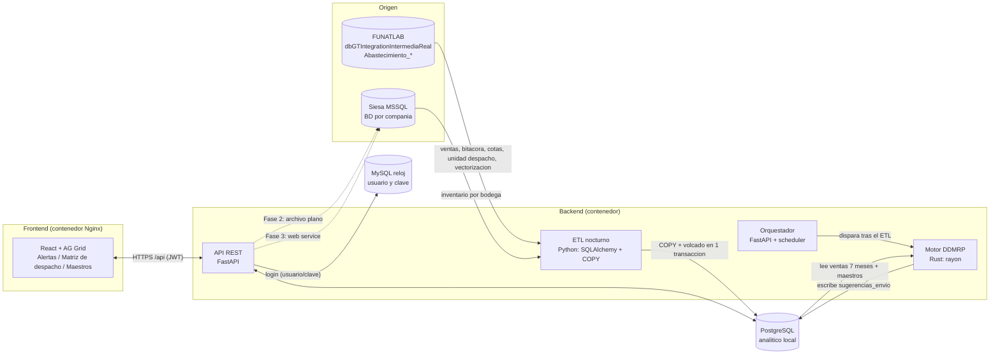

# Arquitectura DDMRP – Abastecimiento diario a tiendas

Escala: ~2.500 productos x 135 bodegas = ~337.500 combinaciones empresa/bodega/referencia por corrida.

## Diagrama de bloques

## Flujo diario
1. 02:00 el orquestador lanza el ETL: replica a Postgres las tablas `Abastecimiento_*` de FUNATLAB y el inventario de Siesa
   (una BD por empresa). El motor ya no consulta los servidores de origen.
2. Corre el binario `ddmrp_core` (subproceso con argumentos fijos, sin shell). Meta < 60 s; en pruebas con 337.448 combinaciones
   y 1,5 M de lineas de venta sinteticas tardo ~9 s.
3. El motor aplica el modelo de `docs/MODELO_DDMRP.md` y escribe `sugerencias_envio` (COPY).
4. Los analistas revisan la **Matriz de despacho** (editar cantidad, aprobar) segun sus permisos.
5. Fase 2: archivo plano para Siesa. Fase 3: envio directo por web service.

## Decisiones clave
- **Rust como binario independiente** (no PyO3): aislamiento, despliegue simple y se puede correr/probar solo.
- **Maestros replicados y editables:** bitacora, cotas, unidad de despacho y vectorizacion se replican desde FUNATLAB. Con
  `SYNC_MAESTROS=true` el ETL los vuelve a cargar cada noche (pisa lo editado en la app); con `false` la app pasa a ser el maestro.
  `pronostico`, `promocion`, `factor_tramo` y `parametro` solo existen en la app.
- **Autenticacion** contra MySQL reloj (tabla USUARIOS, clave md5/bcrypt, solo lectura); **autorizacion** (perfiles por
  bodega/laboratorio) en Postgres (`rbac_asignacion`).
- Toda edicion de maestros queda en `config_audit`.

## Permisos (matriz)
Niveles: `lectura` < `edicion` < `aprobacion`. Una asignacion = (usuario, bodega|*, laboratorio|*, nivel).
El nivel efectivo para (bodega, laboratorio) es el maximo de las asignaciones que aplican. `ADMIN_BOOTSTRAP` define los primeros administradores.
