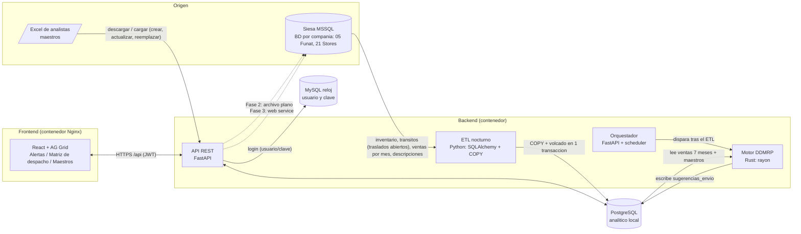

# Arquitectura DDMRP – Abastecimiento diario a tiendas

Escala: ~2.500 productos x 135 bodegas = ~337.500 combinaciones empresa/bodega/referencia por corrida.

## Diagrama de bloques

## Flujo diario
1. 02:00 el orquestador lanza el ETL: trae de Siesa (una BD por empresa) inventario, traslados abiertos (transitos), ventas ya
   agregadas por mes y descripciones. **FUNATLAB ya no se usa.** El motor no consulta los servidores de origen.
2. Corre el binario `ddmrp_core` (subproceso con argumentos fijos, sin shell). Meta < 60 s; en pruebas con 337.448 combinaciones
   y 1,5 M de lineas de venta sinteticas tardo ~9 s.
3. El motor aplica el modelo de `docs/MODELO_DDMRP.md` y escribe `sugerencias_envio` (COPY).
4. Los analistas revisan la **Matriz de despacho** (editar cantidad, aprobar) segun sus permisos.
5. Fase 2: archivo plano para Siesa. Fase 3: envio directo por web service.

## Decisiones clave
- **Rust como binario independiente** (no PyO3): aislamiento, despliegue simple y se puede correr/probar solo.
- **Maestros propios de la app (sin FUNATLAB):** bitacora, cotas, unidad de despacho, vectorizacion, pronostico, promocion,
  DIA por tienda, items, CEDIs, demanda calificada, factores y parametros los alimenta el analista por pantalla
  o por Excel (descargar lo que hay, modificar y cargar: crear nuevos, actualizar o reemplazar todo). El ETL no los toca.
- **Reglas de pedido configurables** (pantalla “Reglas de pedido”, tabla `parametro`): cuando pedir, hasta donde, redondeo,
  vectorizacion, transito, demanda calificada. El motor las lee en cada corrida.
- **DIA de abastecimiento:** `bodega_dia` (una tienda puede estar en varios dias). En la matriz se elige el DIA, se ponen o quitan
  tiendas, y el archivo plano sale solo con esas tiendas.
- **Autenticacion** contra MySQL reloj (tabla USUARIOS, clave md5/bcrypt, solo lectura); **autorizacion** (perfiles por
  bodega/laboratorio) en Postgres (`rbac_asignacion`).
- Toda edicion de maestros queda en `config_audit`.

## Permisos (matriz)
Niveles: `lectura` < `edicion` < `aprobacion`. Una asignacion = (usuario, bodega|*, laboratorio|*, nivel).
El nivel efectivo para (bodega, laboratorio) es el maximo de las asignaciones que aplican. `ADMIN_BOOTSTRAP` define los primeros administradores.
