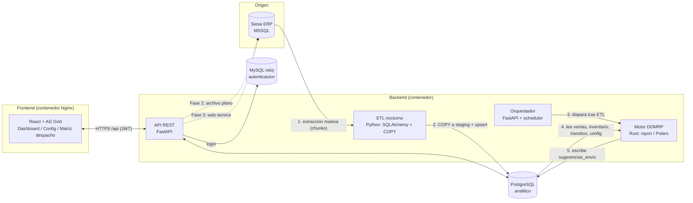

# Arquitectura DDMRP – Abastecimiento diario a tiendas

Escala: ~2.500 productos x 135 bodegas = ~337.500 combinaciones item/bodega por corrida.

## Diagrama de bloques

## Flujo diario
1. 02:00 el orquestador lanza el ETL (Siesa -> Postgres): ventas incrementales, inventario y transitos (snapshot), maestro de items.
2. Al terminar, ejecuta el binario `ddmrp_core` (subproceso con argumentos fijos, sin shell). Meta: < 60 s.
3. El motor lee de Postgres, calcula ADU, zonas, flujo neto y sugerido, y escribe `sugerencias_envio` (COPY).
4. Los analistas revisan la **Matriz de despacho** (editar cantidad, aprobar), segun permisos.
5. Fase 2: generar archivo plano para Siesa. Fase 3: envio directo por web service.

## Decisiones clave
- **Rust como binario independiente** (no PyO3) en esta fase: aislamiento, deploy simple, se puede correr/probar solo. PyO3 queda como opcion si se necesita llamarlo in-process.
- **Datos de lectura** del motor: SELECT por rango; indice compuesto (producto_id, bodega_id).
- **Autenticacion** contra MySQL `reloj`; **autorizacion** (RBAC por bodega/categoria) vive en Postgres (`rbac_asignacion`), no se toca el MySQL.
- **Escrituras** de la UI sobre `maestro_item_bodega_config` quedan auditadas (`config_audit`).

## Permisos (matriz)
Niveles: `lectura` < `edicion` < `aprobacion`. Una asignacion = (usuario, bodega|*, categoria|*, nivel).
El nivel efectivo para (bodega, categoria) es el maximo de las asignaciones que aplican.
